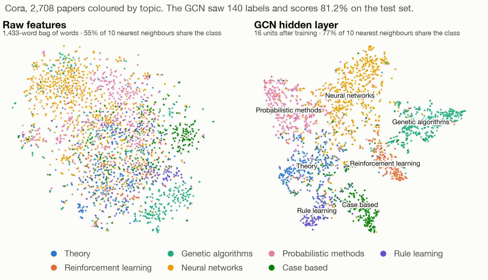
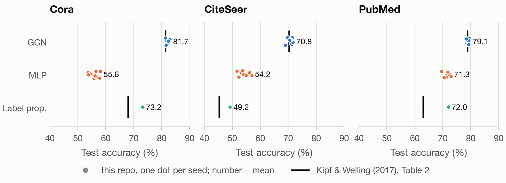

<div align="center">

# Graph convolutional networks for classifying papers in citation networks

Lorenzo Caputi

</div>

**TL;DR.** A graph convolutional network written in plain PyTorch matches the accuracy reported by Kipf & Welling (2017) on Cora, CiteSeer and PubMed. Adding the citations to the words of each paper is worth 8 to 26 points of accuracy, and the trained network groups papers by topic much better than their words alone.

## Abstract

Semi-supervised node classification asks for the labels of every node in a graph when only a few are given. Graph convolutional networks (GCNs) [1] solve it by averaging each node's features with those of its neighbours before every layer. We reimplement the two-layer network of [1] without a graph library and train it on the three citation graphs of the paper, where the nodes are papers, the edges are citations and the labels are topics, with 20 labelled papers per topic. Over 10 seeds it reaches 81.7%, 70.8% and 79.1% test accuracy on Cora, CiteSeer and PubMed, within one point of the published 81.5%, 70.3% and 79.0%. The same network without the citations loses 26, 17 and 8 points. Label propagation, which uses the citations but not the words, scores between the two on Cora and PubMed but below both on CiteSeer. In the trained network's hidden layer, 77% of each paper's 10 nearest neighbours share its topic, against 55% in the raw word counts.

<picture>
  <source media="(prefers-color-scheme: dark)" srcset="figures/tsne-cora-dark.png">
  
</picture>

**Figure 1.** The 2,708 papers of Cora drawn in two dimensions with t-distributed stochastic neighbour embedding (t-SNE) [4] and coloured by topic, from their word counts (left) and from the 16 hidden units of the trained network (right). The network saw the topics of only 140 of them.

## 1. Problem

Each dataset is a graph of scientific papers with an edge whenever one paper cites another. Every paper has a topic and a vector $x_i$ of word counts. Only 20 papers per topic are labelled, and the task is to predict the topics of the others, scored on 1,000 test papers with the public splits of [2]:

**Table 1.** The three citation graphs.

| Dataset | Papers | Topics | Words | Labelled papers |
|---|---:|---:|---:|---:|
| Cora | 2,708 | 7 | 1,433 | 140 |
| CiteSeer | 3,327 | 6 | 3,703 | 120 |
| PubMed | 19,717 | 3 | 500 | 60 |

Papers that cite each other tend to share a topic, so the citations carry information that the words alone do not. The question is how much of it a model can use with so few labels.

## 2. Model and baselines

A graph convolution replaces each paper's vector by a weighted average of its own and its neighbours' vectors, then applies a linear map. With $A$ the adjacency matrix plus self-loops and $D$ the diagonal matrix of its degrees, the averaging matrix is $\hat A = D^{-1/2} A D^{-1/2}$, and the two-layer network of [1] gives the topic probabilities of all papers at once:

$$Z = \mathrm{softmax}\big(\hat A \ \mathrm{ReLU}(\hat A X W_0)\ W_1\big).$$

The weights $W_0$ and $W_1$ are trained by minimizing the cross-entropy on the labelled papers only, so each prediction draws on the words of every paper within two citations. The training follows the paper: 16 hidden units, dropout 0.5, weight decay on the first layer, Adam with learning rate 0.01, and up to 200 epochs with the early stopping of the reference code.

Two baselines separate the two sources of information. The first is the same network with $\hat A$ replaced by the identity, which sees the words but not the citations. The second is label propagation [3], which spreads the known labels along the citations and ignores the words.

## 3. Results

**Table 2.** Test accuracy (%), mean over 10 seeds.

| Method | Cora | CiteSeer | PubMed |
|---|---:|---:|---:|
| GCN, this reimplementation | 81.7 | 70.8 | 79.1 |
| GCN, as reported in [1] | 81.5 | 70.3 | 79.0 |
| Same network without the citations | 55.6 | 54.2 | 71.3 |
| Label propagation [3] | 73.2 | 49.2 | 72.0 |

The reimplementation lands within one point of the paper on every dataset (standard deviations over seeds 0.4 to 1.7 points; the paper averages 100 runs). Dropping the citations costs 26 points on Cora, 17 on CiteSeer and 8 on PubMed. Using only the citations beats using only the words on Cora and PubMed but not on CiteSeer, where 310 of the 1,000 test papers lie in parts of the graph that contain no labelled paper at all, so label propagation cannot reach them.

<picture>
  <source media="(prefers-color-scheme: dark)" srcset="figures/accuracy-dark.png">
  
</picture>

**Figure 2.** Test accuracy of every run, one dot per seed, with the values reported in [1] as black bars.

The hidden layer shows what the citations add (Figure 1). In the raw word counts, 55% of each Cora paper's 10 nearest neighbours share its topic; in the 16 hidden units of the trained network, 77% do, although the network was told the topics of only 140 papers.

## Reproducing the results

With Python 3.11 or later:

```sh
git clone https://github.com/lorenzocaputi/gcn-citation-networks.git
cd gcn-citation-networks
python3 -m venv .venv && . .venv/bin/activate
pip install -e ".[dev]"
make reproduce
```

`make reproduce` downloads the datasets from [kimiyoung/planetoid](https://github.com/kimiyoung/planetoid) (the files used by [1], checked by hash), trains every model and redraws the figures in about 9 minutes on a laptop CPU. It writes Table 2 to [RESULTS.md](RESULTS.md) and every run to `results/accuracy.csv`. `make check` runs the tests.

## References

1. T. N. Kipf and M. Welling. Semi-supervised classification with graph convolutional networks. *ICLR*, 2017. https://arxiv.org/abs/1609.02907
2. Z. Yang, W. W. Cohen and R. Salakhutdinov. Revisiting semi-supervised learning with graph embeddings. *ICML*, 2016. https://arxiv.org/abs/1603.08861
3. X. Zhu, Z. Ghahramani and J. Lafferty. Semi-supervised learning using Gaussian fields and harmonic functions. *ICML*, 2003.
4. L. van der Maaten and G. Hinton. Visualizing data using t-SNE. *Journal of Machine Learning Research* 9, 2579–2605, 2008.
